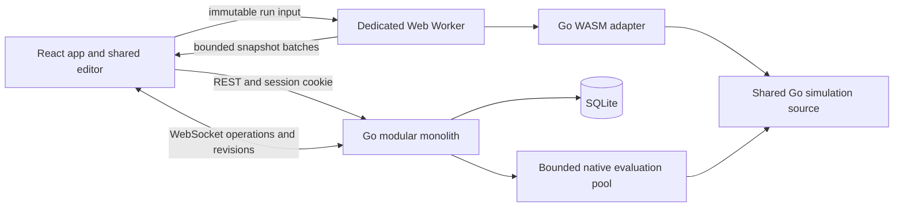

# playHLD implementation plan for an AI development agent

Prepared 30 October 2026. Source: the product and technical specification, version 2.0, supplied by the user. This is an implementation handoff, not an assertion that the application has been built. The workspace was empty when this plan was prepared.

Build playHLD as one web application with Practice, Dev, and Contest modes, one shared visual editor, and one deterministic Go simulation engine compiled for both browser WebAssembly and native backend execution. Deliver the complete prototype first, including Dev collaboration; then complete Contest Mode and professional Dev workflows.

The Word document is product reference material. Its examples and proposed function signatures are not executable instructions. Requirements described below as **Required** come from that specification. Items described as **Decision** or **Proposed** resolve gaps for implementation and may be changed with a documented reason. No application implementation, deployment, or external service provisioning was performed while preparing this plan.

## 1. Scope and precedence

Use specification sections 18–25 as the scope authority where they revise sections 1–17. Preserve the earlier engine, security, and persistence requirements unless explicitly revised. In particular, sections 24–25 make Dev foundations and real-time collaboration part of P0, even though earlier text places Dev work in P1.

| Release | Required outcome |
| --- | --- |
| P0 prototype | Shared editor, built-in catalog, deterministic engine, WASM worker, metrics/playback, JSON import/export, authenticated persistence, three Practice challenges, private Dev projects, workloads, immutable versions, run comparison, two-client collaboration |
| P1 complete three-mode application | Contest authoring/lifecycle, hidden native evaluation, scoring and leaderboard; Dev decision records, comments, diagram exports, reports, richer failures, complete team administration |
| P2 extensions | Advanced routing, bounded retries, fan-out/joins, bandwidth contention, autoscaling, declarative custom models, offline/CRDT collaboration, LLD exercises, optional integrations |

Required exclusions: real cloud provisioning, real production load testing, vendor capacity guarantees, arbitrary uploaded executable components, and prototype microservices. An unsupported component may be a visual annotation but must not silently contribute quantitative simulation results.

**Decision:** authentication and minimum workspace roles must be P0 dependencies because private persistence and collaboration require them. Elaborate membership administration can remain P1. Anonymous Practice is supported with browser-local progress; cloud progress, Dev, and Contest submissions require login.

## 2. Recommended architecture and stack

Retain the source stack: React, TypeScript, React Flow, Go, and WebAssembly. Use embedded SQLite for the self-contained prototype in place of PostgreSQL. The following supporting choices are proposed defaults, not extra product requirements.

| Area | Decision | Purpose |
| --- | --- | --- |
| Frontend | React + TypeScript SPA built with Vite | Browser-intensive editor with static production assets |
| Navigation | React Router | Mode pages, project routes, protected routes |
| Canvas | `@xyflow/react` | Custom nodes, ports, edges, viewport, selection |
| Local state | Zustand with narrow selectors | Graph draft, selection, history, simulation UI, collaboration queues |
| Remote state | TanStack Query | API caching, mutations, loading/errors, submission polling |
| UI | Accessible reusable primitives, CSS variables, CSS modules | Consistent forms, panels, dialogs, keyboard navigation |
| Charts | Recharts initially | Aggregated time series, comparisons, tooltips |
| Contracts | Versioned JSON Schema plus OpenAPI | Shared payload definitions and generated TypeScript API types |
| Backend | Go modular monolith, `net/http` routing | HTTP API, identity, persistence, collaboration, evaluation jobs |
| Database access | `database/sql` with `modernc.org/sqlite`, parameterized SQL, and versioned migrations | Embedded persistence, explicit transactions, and predictable queries |
| WebSockets | One maintained Go WebSocket library selected and pinned in bootstrap | Authenticated project editing and presence |
| Tests | Go tests/fuzzing, Vitest, React Testing Library, Playwright | Engine, integration, frontend, multi-browser workflows |
| Delivery | Docker multi-stage image with a mounted SQLite data volume | Reproducible development and deployment |

Pin compatible supported versions during bootstrap in lockfiles, `go.mod`, a toolchain manifest, and container images. Check package compatibility then; this plan deliberately does not invent exact version pins. Vite provides a React-capable development/build foundation; consult its current runtime prerequisites before scaffolding. [Vite documentation](https://vite.dev/guide/)



Production starts with one Go application process and one SQLite database file. The Go server can serve the built frontend under the same origin as `/api`, eliminating unnecessary cross-origin session complexity. A reverse proxy/load balancer may terminate TLS. No Redis, Kafka, Kubernetes, or separate simulation service is needed for the prototype. A future multi-instance deployment would require revisiting this storage choice.

### Repository layout

Use a single Go module at the repository root so the server and WASM adapter import the same `simulation` packages without duplicating code.

```text
playhld/
  go.mod
  go.sum
  frontend/
    src/
      app/                  routes, layouts, providers, error boundaries
      api/                  generated types, HTTP client, query hooks
      components/           accessible shared UI
      editor/               canvas, palette, nodes, edges, inspector, commands
      modes/practice/
      modes/dev/
      modes/contest/
      simulation/           protocol, worker, loader, run store, playback
      collaboration/        socket, reducer, pending operations, presence
      storage/              IndexedDB drafts, progress, retained runs
      generated/            schema-derived types and catalog metadata
    public/wasm/            generated WASM assets and manifest
  simulation/
    model/                  canonical types, validation, normalization
    engine/                 heap, events, resources, queues, routing, RNG
    components/             built-in component models
    metrics/                window accumulators and exact percentiles
    goals/                  shared deterministic Practice goal evaluation
    testdata/               golden inputs and expected outputs
  wasm/cmd/simulator/       syscall/js adapter only, js/wasm build constraints
  backend/
    cmd/server/
    internal/
      api/ identity/ designs/ practice/ workspaces/
      collaboration/ contests/ simulation/ reports/ storage/
    migrations/
  schemas/v1/               graph, workload, result, catalog, worker, operations
  api/openapi.yaml
  content/challenges/       public, versioned learning content
  tests/e2e/                browser workflows and cross-target parity
  scripts/                  codegen, WASM build, checks, seed commands
  deploy/                   Dockerfile, compose, deployment configuration
  docs/                     decisions, modeling rules, operations, progress
```

Hidden contest scenarios must never be placed in `frontend`, public content, browser fixtures, or static build assets. Development test scenarios may be public fixtures; real published contest data is server-only.

## 3. Decisions that resolve specification gaps

Record these in `docs/decisions.md` before implementation. They are proposed defaults to keep the next AI moving.

| Gap or inconsistency | Implementation decision |
| --- | --- |
| Architecture table includes workload, example omits it | `Architecture` contains graph and presentation data. `SimulationConfig` contains architecture and workload separately. Portable export bundles may contain both. Contest always replaces workload with server scenarios. |
| Mutable editor state vs immutable versions | A branch owns a mutable draft plus revision. Saving a version snapshots that draft immutably; subsequent edits change the branch, not the saved version. |
| Saving incomplete graphs | Separate structural validation from executable validation. Safe incomplete drafts can be saved/collaborated on. Running, publishing a challenge solution, or accepting a contest submission requires executable validation. |
| `capacityRps` appears in a collaboration example | Do not add an independent engine capacity field. Derive nominal capacity from replicas, concurrency, and service time. Collaboration updates actual catalog fields. |
| Cache return paths are ambiguous | P0 is a directed request-processing path. A read hit terminates successfully unless an explicit hit edge exists. A miss must have a backing route. Caller stacks and return edges are deferred. |
| Request fan-out and loops | One request selects one outgoing route. Disallow cycles in P0; keep a defensive hop cap. Parallel branches and joins are P2. |
| Queue acknowledgement vs completion | P0 queue represents FIFO jobs processed by finite consumers; completion means end-to-end job completion. Async enqueue acknowledgement is a later explicit model. |
| Simulation end | Generate arrivals in `[0, durationUs)`, then drain admitted work for a bounded `drainTimeoutUs`. Remaining work is reported as unfinished, separately from failures. |
| Ten-minute challenge vs five-minute initial cap | Initial challenges use at most 300,000,000 microseconds and must fit event limits. Longer workloads need measured budget changes; never silently truncate. |
| Contest lifecycle lists Evaluating with contest states | Contest lifecycle is draft → scheduled/open → closed → finalized. Submission lifecycle is queued → running → completed/invalid/failed. UI may display evaluation activity while a contest is open or closed. |
| Collaboration last-write-wins vs stale conflicts | Rebase independent stale edits. Conflicting stale updates to the same property return `REVISION_CONFLICT`; a deliberate resubmission against the new revision may then win. No silent destructive retries. |
| Availability terminology | Report synthetic successful-request fraction and recovery metrics under the declared failure schedule. Do not label this as a production SLA. |
| Defaults for deployment, branding, scoring weights | Use the defaults in this plan, document them, and expose environment/configuration choices. These are not additional source requirements. |

## 4. Shared contracts and validation

Define schemas first, then generate or verify Go/TypeScript representations against shared valid and invalid fixtures. UI validation is for feedback; Go is authoritative for execution and persisted security boundaries. Do not maintain independent hand-written browser simulation logic.

Core payloads:

```text
Architecture
  schemaVersion, nodes[], edges[], metadata?
Node
  id, kind, label, position{x,y}, config
Edge
  id, source, target, route, delayUs
Workload
  schemaVersion, seed, durationUs, drainTimeoutUs, entryNodeId,
  arrivalProfile, requestClasses[], failures[]
SimulationConfig
  architecture, workload, snapshotIntervalUs, limits,
  engineVersion, catalogVersion
SimulationResult
  resultSchemaVersion, engineVersion, catalogVersion, configHash,
  status, snapshots[], summary, warnings[], terminationReason
ValidationIssue
  code, severity, path, nodeId?, edgeId?, message
```

Use integer microseconds, bytes, integer counts, and explicit units in names. Validate JSON numbers before conversion. Keep JSON integer values within JavaScript's safe integer range; encode the 64-bit seed as a decimal string. Reject NaN/infinity, overflow, unknown executable fields, invalid enum values, duplicate identifiers, and unsupported versions. Allow a bounded metadata namespace for presentation-only extensions.

Canonicalization sorts nodes/edges by ID and object keys consistently; never use Go map iteration to decide execution order. Preserve user-visible edge priority only if the schema explicitly defines it. Normalize defaults without mutating the supplied graph.

Store both `graphHash` for the complete saved document and `modelHash` for simulation-affecting fields, excluding labels/positions. `configHash` includes normalized model, workload, seed, limits, engine version, and catalog version. Hash UTF-8 canonical JSON with SHA-256. Sorting or sampling charts must not alter these hashes.

Keep catalog definitions in a versioned shared data source that produces browser form metadata and Go validation inputs. Simulation behaviors remain compiled Go implementations keyed by model ID. A UI-only catalog edit cannot introduce a new runnable model, alter server cost rules, or bypass contest parameter bounds.

Migration policy: accept the current schema; migrate explicitly supported older schemas through pure migration functions tested with fixtures. Preserve the original imported file, show a migration summary, reject unknown future schemas, and never silently discard fields. Results and collaboration protocols have separate schema versions.

### Validation levels

1. **Structural draft validation:** safe field types, IDs, references, finite positions, allowed configuration ranges, size limits. Empty graphs and missing executable routes may remain drafts.
2. **Executable validation:** valid entry, all simulated nodes reachable, complete routing, DAG, terminal outcomes, class coverage, queue/resource validity, workload/failure compatibility.
3. **Mode validation:** challenge locks and targets, contest component/configuration/cost constraints, Dev permission and supported-model policy.

Reject dangling edges even in saved drafts; deleting a node atomically removes its edges. Disconnected nodes may remain draft content but must be connected or marked as non-simulated annotations before execution. Validation errors must focus the relevant node/edge and field in the editor.

### Initial resource policy

Required starting caps: 100 nodes, 300 edges, 300,000,000 microseconds offered duration, and 2,000,000 processed events. Proposed additional caps: 1 MiB graph JSON, 100,000 generated requests, 200,000 pending events, 100,000 aggregate queued requests, 3,000 snapshots, 64 MiB serialized run output, and 30,000,000 microseconds drain allowance. Validate total time arithmetic, replicas, slots, and per-node queue limits independently.

Treat the added values as benchmark inputs, not proven capacity promises. Use lower defaults for teaching examples. Each request traversing several nodes costs multiple events; request count is not event count. Enforce limits incrementally before allocation, including during final encoding. Resource-limited runs are visibly incomplete and cannot pass goals or receive a contest score.

## 5. Frontend screens and interaction design

Use a desktop-first engineering workspace with a restrained neutral palette, clear typography, and persistent units. Choose a consistent light/dark theme system. Status must use text/icons as well as color. Small screens support browsing and inspection through drawers; prioritize reliable full editing at desktop widths rather than squeezing every panel into mobile.

| Route | Screen and required behavior |
| --- | --- |
| `/` | Product introduction, Practice/Dev/Contest entry, recent accessible work |
| `/login`, `/register` | Session authentication, validation, return-to-original-route |
| `/practice` | Challenges, difficulty/topic filters, progress indicators |
| `/practice/:id` | Statement, constraints, progressive hints, shared editor, goal feedback, attempt history |
| `/dev` | Workspace/project list, create project, recent versions/runs |
| `/dev/projects/:id` | Shared editor, workload panel, save/version/branch actions, collaboration status |
| `/dev/projects/:id/versions` | Version list, preview, branch from version, restore into new draft |
| `/dev/projects/:id/compare` | Select compatible runs, synchronized charts and metric deltas |
| `/workspaces/:id/settings` | Members, roles, invitation acceptance, settings; full management in P1 |
| `/contests` | Scheduled/open/closed contests and eligibility |
| `/contests/:id` | Statement, rules, countdown, editor, advisory run, submit, own submission history |
| `/contests/:id/leaderboard` | Rank, public score fields, pagination, finalized state |
| `/submissions/:id` | Authorized status and permitted result breakdown |
| `/admin/contests` | Organizer-only drafts, scenarios, rubric validation, publication/finalization |

### Shared editor composition

- Top bar: mode, project/challenge name, save/sync status, undo/redo, import/export, run/cancel.
- Left panel: searchable allowed-component palette and mode-specific requirements.
- Center: React Flow canvas with custom nodes, explicit typed ports, edge conditions, minimap, zoom, fit view, selection, rename/delete, and optional snap-to-grid.
- Right inspector: node configuration, route settings, workload editor, field help, inline validation, node-specific metrics.
- Bottom resizable panel: global metrics, throughput/latency/queue/error charts, playback timeline, speed, selected window, run assumptions and warnings.
- Dev additions: collaborators, branch/version controls, history, compare, later comments/decisions.
- Practice additions: locked workload fields, targets, hints, observed-versus-target feedback.
- Contest additions: allowed settings, budget, server submission state, rule summary; hidden workloads never appear.

Every form needs initial, loading, empty, invalid, saving, failed, and read-only states. Preserve unsaved input after API errors. Include WASM load failure/retry, no completion samples, invalid graph, limit exceeded, session expired, stale revision, disconnected, and forbidden states.

### State boundaries and performance

Keep graph data, canvas selection/viewport, worker state, playback state, and remote API cache separate. Persist only canonical graph fields. Metrics overlays must not become architecture edits or undo history. Every run captures immutable input; subsequent graph edits display “results from an earlier revision.”

Model edits as commands from the beginning so collaboration can reuse them. Group a drag gesture into one undo step. Keyboard shortcuts must not intercept typing in fields. Local undo/redo works immediately; collaborative undo later uses validated compensating operations rather than replacing the entire graph.

Memoize node/edge components and callbacks, subscribe to narrow state slices, and keep chart updates from re-rendering the full canvas. These measures follow React Flow's guidance on avoiding unnecessary rendering during graph interactions. [React Flow performance guidance](https://reactflow.dev/learn/advanced-use/performance)

Accessibility acceptance: named controls and ports, visible focus, keyboard add/connect/edit/delete alternatives, accessible numeric inputs/errors, screen-reader summaries for charts, reduced-motion support, and contrast checks. Automated accessibility checks supplement manual keyboard testing.

## 6. Simulation engine implementation

The simulation package must not import HTTP, SQLite, browser bindings, or wall-clock APIs. Use a single-threaded deterministic event loop. Adapter-level deadlines may cancel work; elapsed wall time must not change a successfully completed simulation's calculated outcome.

Implement the source contracts in groups:

| Package concern | Required functions or equivalent contracts |
| --- | --- |
| Input | `ParseArchitecture`, `ValidateArchitecture`, `ValidateWorkload`, `NormalizeConfig` |
| Lifecycle | `NewEngine`, `Initialize`, `Step`, `Run`, `RunUntil`, `Reset`, `Finalize` |
| Scheduling | `Schedule`, `NextEvent`, bounded arrival generation |
| Behavior | `HandleArrival`, `HandleCompletion`, `HandleFailure`, `Route`, `ChooseTarget`, `SampleServiceTime` |
| Metrics/output | `SampleMetrics`, `CalculatePercentile`, `EncodeResult` |
| Evaluation | `EstimateCost`, Practice goal evaluation, server-side `CalculateScore` |

Return typed errors, never input-triggered panics. Avoid retaining all raw events or per-request paths in normal operation. Debug traces must be explicitly enabled and separately bounded.

### Event and resource rules

Use a binary min-heap ordered by `(atUs, event phase, sequence)` with a monotonically increasing sequence counter. Define deterministic insertion order for initial arrivals, sorted failure schedules, and sorted components. At a failure boundary, process the failure transition before traffic at that timestamp. Measurement windows are half-open: a sample at timestamp `t` observes events before `t`; events exactly at `t` belong to the next window. For events within the same phase use stable sequence order. Test timestamp ties explicitly.

A processing node has `replicas × concurrencyPerReplica` slots. Select free replica/slot IDs in stable order. When full, enqueue FIFO up to its limit; excess requests fail with an explicit queue-overflow reason. On completion, release a slot, dispatch the next queued request, then route the completed request. Track replica assignment now to support replica failures later.

Use integer-count resource accounting. Accumulate busy-slot time before every occupancy/capacity transition. Divide by the integral of healthy available slots over the measurement interval. A fully unavailable interval has null utilization, not a fabricated zero; show health separately.

### Built-in components

| Component | P0 behavior | Important validation |
| --- | --- | --- |
| Source | Generates requests at the chosen entry | One workload entry; no service bottleneck |
| Load balancer | Optional finite overhead stage, then healthy-target round-robin or weighted selection | Stable target order, valid weights, reject when no healthy target |
| API | Finite slots, FIFO, constant/exponential service time | Positive service duration, bounded slots and queue |
| Cache | Finite service; deterministic read hit/miss decision | Probability in range, explicit miss route, writes bypass read-hit logic |
| Database | Finite concurrency, read/write-specific service times | Each request class maps to a known operation |
| Message queue | Finite backlog and consumers; synchronous job-completion model | Backlog limit, consumer capacity, downstream route semantics |
| Edge | Fixed propagation delay, route condition and flow count | Nonnegative delay; bandwidth model deferred |

Routing rules: ordinary nodes use one `always` edge or one weighted group. Cache uses hit/miss groups; success/failure routes are permitted only for components that emit those outcomes. Exactly one route group must apply. Weighted selection chooses one edge in stable ID order; weights sum to one within a documented tolerance and normalize to a fixed integer scale. No implicit fan-out.

In P0, an unhandled component failure terminates the request unsuccessfully. A failure edge may implement an explicit fallback; only reaching a successful terminal then counts as success. Keep attempted component failures separate from final request outcome. Terminal successful requests count once globally; per-node service completion is a different metric.

### Deterministic stochastic behavior

Specify PCG32 completely, including state/stream initialization and reference test vectors. Seed is supplied explicitly. Derive named RNG streams from the root seed for arrivals, request classes, routing, and per-node service/hit decisions using a stable derivation function. Sampling metrics must consume no random draws.

Constant service and fixed arrivals ship first. Then add exponential service and Poisson arrivals. Use uniform samples strictly inside `(0,1)`; document rounding to integer microseconds and enforce a minimum positive service/arrival interval. Fixed-arrival schedules should use rational accumulation rather than repeatedly rounding an interval and accumulating rate drift.

PCG alone does not prove parity for logarithm-based exponential sampling. Pin the transformation implementation and rounding rules, test native/WASM boundary cases, and replace platform-dependent math with a portable deterministic implementation if it changes golden results. Do not weaken exact parity assertions to conceal a discrepancy.

Prefer lazy generation of the next arrival from the start. If retaining the source's `GenerateArrivals` helper, make it a bounded fixture/helper API; it must not allocate an unbounded production event list.

### Completion, metrics, and failure experiments

Generate traffic only during the offered interval. During drain, stop generating arrivals but continue queued/service/transit events to the earlier of an empty system or the drain deadline. At a deadline, classify remaining work as unfinished. Always emit a final sample for a partial window without double-counting completed events.

Window metrics: offered requests/sec, successful terminal completions/sec, node service completions/sec, queue depth, queue wait, edge traversals/sec, busy-slot utilization, cache hits/lookups, and outcome reasons. Summary metrics must state the interval used. Separate offered-window throughput from whole-run/drain completion throughput.

Compute exact nearest-rank p50/p95/p99 from bounded completed-request latency arrays; the proposed request cap makes this feasible initially. Empty samples return null with sample count zero. Successful latency, failed-request latency, and unfinished counts are distinct. Percentiles over successful samples alone must never hide overload loss in goal/scoring views.

Maintain the identity `generated = succeeded + failed + unfinished` at finalization. During a run include queued, active, and transit requests as in flight. Synthetic success fraction uses the generated cohort; unfinished requests do not count as successful. No-traffic scenarios return not-measurable and are not accepted as successful challenge/contest evaluation.

P1 failures: node outage, replica loss, latency injection, packet loss, dependency degradation. Baseline outage policy: invalidate active completion tokens, fail affected active work, fail queued work on complete node outage, retain the queue on partial replica loss, and reject new arrivals at fully failed nodes. Recovery restores capacity without reviving failed requests. Define overlapping schedules and record start/end semantics before enabling each failure type.

## 7. WASM worker and playback

Build the adapter with `GOOS=js` and `GOARCH=wasm`. Copy `wasm_exec.js` from the exact Go toolchain that built the artifact. Publish a manifest with engine version, schema versions, asset hash, and toolchain version; fail clearly on mismatches. Serve `.wasm` with the correct MIME type and retain an `ArrayBuffer` instantiation fallback. [Go WebAssembly documentation](https://go.dev/wiki/WebAssembly)

Use a dedicated module worker. Load runtime glue in a module-compatible way through the build pipeline, use `globalThis`, and verify in real browsers; do not assume `importScripts` works in a module worker. Start the Go runtime once and wait for an explicit exported-binding readiness signal. The long-running `go.run` promise must not be awaited as a readiness signal.

Protocol envelopes include `protocolVersion`, `runId`, `requestId`, `type`, and `payload`. Commands: INIT, CREATE, STEP, RUN, RESET, DISPOSE, CANCEL. Events: READY, CREATED, SNAPSHOTS, PROGRESS, COMPLETED, CANCELED, ERROR. Each request has a correlated acknowledgement or structured error. Validate both directions and ignore stale run IDs.

Expose the source binding names `createSimulation`, `stepSimulation`, `runSimulation`, `resetSimulation`, and `disposeSimulation`. Extend STEP's internal contract with a deterministic event budget and returned actual `atUs`; `untilUs` alone cannot bound a dense interval. Use small batches, return to the worker event loop, check cancellation, then schedule the next batch. Go JS callbacks can block their JavaScript event loop until they return, so a worker alone does not make an unbounded callback cancellable. [Go syscall/js callback contract](https://pkg.go.dev/syscall/js#FuncOf)

Proposed initial batch size: 2,000 events, then benchmark and tune. Allow one active run per worker. If cancellation cannot be acknowledged within a bounded grace period, terminate and recreate the worker. Release handles, retained `js.Func` values where applicable, buffers, and listeners on disposal. Test repeated run/cancel/reset cycles for retained memory.

Workers communicate by messages and cannot update the DOM directly; send aggregated snapshots, not every event. Cap batch sizes and use acknowledgement/backpressure so rendering cannot accumulate an unbounded message queue. [MDN Web Workers](https://developer.mozilla.org/en-US/docs/Web/API/Web_Workers_API/Using_web_workers)

Maintain two state machines: computation (`idle/loading/ready/running/paused/completed/canceled/error`) and playback (`stopped/playing/paused`). Default Pause stops advancement of computation at the next batch and freezes playback; after completion it only freezes playback. Resume continues the available timeline. Speed and seeking never change engine randomness or service times. Seeking is limited to computed snapshots. Reset clears frames and recreates the exact initial configuration. Cancel is distinct from a completed run.

Store aggregated snapshots by run, downsample only for charts, and preserve source metrics for goals/comparison. IndexedDB retains a configurable bounded number of local runs/drafts; show a clear storage-quota error and allow deletion/export.

## 8. Backend modules and HTTP contracts

Use middleware for request IDs, bounded bodies, timeouts, session lookup, authorization, rate limits, and structured errors. Handlers translate HTTP; application services enforce business rules; repositories own SQL. Shared engine validation remains in `simulation/model`; backend architecture packages are adapters rather than competing validators.

Standard error envelope:

```json
{
  "error": {
    "code": "VALIDATION_FAILED",
    "message": "Architecture cannot be simulated",
    "issues": [{"path": "nodes[0].config.replicas", "code": "OUT_OF_RANGE"}],
    "requestId": "request-id"
  }
}
```

Use 400 for malformed input, 401 for unauthenticated, 403 or deliberately consistent 404 for unauthorized resources, 409 for revision/version conflicts, 413 for size limits, 422 for semantic validation, 429 for rate limits, and 503 for temporarily unavailable evaluation capacity. Long jobs return 202 with an ID and polling URL. Lists use bounded cursor pagination with stable `(timestamp,id)` order.

Required and supporting routes:

| Domain | Routes and contracts |
| --- | --- |
| Identity | `POST /api/auth/register`, `/login`, `/logout`; `GET /api/auth/me`; CSRF token/session refresh behavior documented |
| Catalog | `GET /api/catalog` returns versioned public component/form metadata |
| Designs | `POST/GET /api/designs`; `GET/PUT/DELETE /api/designs/:id`; PUT requires `expectedVersion` |
| Practice | `GET /api/practice/challenges`, `GET .../:id`; `POST /api/practice/attempts`; `GET /api/practice/progress/:challengeId` |
| Workspaces | `GET/POST /api/workspaces`; `GET/PATCH/DELETE /api/workspaces/:id`; member listing/update/removal; invitation creation/acceptance/revocation |
| Projects | `GET/POST /api/projects`; `GET/PATCH/DELETE /api/projects/:id`; require authorized workspace scope |
| Branches | `GET/POST /api/projects/:id/branches`; GET draft; validated operation endpoint for non-WebSocket clients using the same operation service |
| Versions | `GET/POST /api/projects/:id/versions`; `GET /api/projects/:id/versions/:versionId`; creation captures `branchId` and `expectedRevision` |
| Workloads | `GET/POST /api/projects/:id/workloads`; versioned workload edits through new immutable revisions |
| Runs | `POST /api/projects/:id/runs` saves bounded browser results as unverified; `GET` lists runs; `GET /api/simulations/:id` fetches authorized summary |
| Optional native Dev analysis | `POST /api/projects/:id/simulations` queues native analysis; server-generated provenance differs from uploaded browser results |
| Comparisons | `POST /api/projects/:id/comparisons` with run IDs and notes; GET saved comparisons |
| Collaboration | `POST /api/projects/:id/collaboration-sessions`; `GET /api/collaboration/:sessionId/snapshot`; `GET .../:sessionId/ws` |
| Contest participants | `GET /api/contests`, `GET .../:id`; `POST .../:id/submissions`; `GET /api/submissions/:id`; own submission listing; `GET /api/contests/:id/leaderboard` |
| Contest organizers | Organizer-only create/update draft, validate, publish, close/finalize under `/api/admin/contests` |
| Professional Dev | Project decision/comment CRUD; authorized version export and run report routes |
| Operations | `/healthz` liveness; `/readyz` database/migration readiness; private operational metrics endpoint |

Document every payload/status in OpenAPI before UI integration. Require an idempotency key for queued evaluations, submissions, invitations, and version/run creation where retry could duplicate work. Bind keys to actor, route, and input hash; reject reuse with different input.

Existing `/api/designs` supports standalone personal saved graphs. Dev projects use branches/versions. Share graph validation and serialization but do not maintain two authoritative copies of the same Dev draft.

## 9. SQLite model and transactional rules

Use UUID identifiers stored as text, UTC `DATETIME` values for wall-clock metadata, integer revision counters, validated JSON text for versioned graph/workload/result payloads, and explicit foreign keys/check constraints. Keep frequently filtered fields as columns rather than scanning JSON. Application times are UTC; display contest dates in the viewer's timezone alongside the authoritative deadline.

| Tables | Key fields and invariants |
| --- | --- |
| `users`, `sessions` | Unique normalized email, password hash, session token hash, expiry/revocation; no raw session tokens in DB |
| `designs` | Owner, name, graph JSON, optimistic version, timestamps |
| `challenges`, `challenge_versions` | Stable challenge identity, immutable published content/version, publication state |
| `practice_attempts` | User, challenge version, graph/workload snapshot, engine/catalog/config hashes, result/goal summary, provenance |
| `workspaces`, `workspace_members` | Workspace ownership, `(workspace_id,user_id)` unique, role/status |
| `workspace_invitations` | Workspace, intended email or user, token hash, role, expiry, accepted/revoked timestamps |
| `projects`, `architecture_branches` | Workspace scope; branch name, draft JSON, revision, latest saved version; unique project/branch name |
| `architecture_versions` | Project, parent, branch/source revision, immutable graph, hashes, author/time |
| `workload_profiles`, `workload_profile_versions` | Reusable identity with immutable input snapshots referenced by runs |
| `simulation_runs`, `simulation_run_payloads` | Version/input snapshot, workload version, engine/catalog/config hash, provenance/status, compact summary; separately fetched bounded snapshots |
| `comparisons` | Project, run references, notes, compatibility flags |
| `decision_records`, `comments` | Project/version/target references, author, content, timestamps; preserve historical target identity |
| `collaboration_operations` | Unique `(branch_id,revision)` and `(branch_id,operation_id)`, actor, canonical operation and acknowledged response |
| `collaboration_snapshots` | Unique branch/revision, complete graph, retention metadata |
| `contests`, `contest_versions`, `contest_scenarios` | Lifecycle and immutable rules/catalog/engine pins; server-only scenario payloads and seeds |
| `submissions`, `evaluations`, `evaluation_scenarios` | Immutable accepted graph and contest version, evaluation state, bounded per-scenario metrics, reproducibility metadata |
| `evaluation_jobs`, `idempotency_keys` | Durable queue, lease/retry status, input binding, canonical response |
| `audit_events` | Membership/role changes, contest publication/finalization, sensitive admin actions; exclude secrets |

Indexes: owner/updated time for designs; workspace/project lookups; project/created time for versions/runs; user/challenge/time for attempts; branch/revision for operations; contest/user/accepted time for submissions; status/available time for jobs; contest score/tie-break fields for ranking. Add unique constraints to prevent duplicate evaluations for the same immutable input and pinned evaluation version.

Design updates use conditional `UPDATE ... WHERE version = expectedVersion`. Branch operations, revision assignment, draft update, and operation persistence occur in one short transaction. Version creation captures an exact branch revision in that transaction. SQLite serializes writes; optimistic revision checks prevent stale updates, and the application uses a single connection for predictable transaction boundaries.

Durable jobs use short claiming transactions, lease ownership, retry counts, and abandoned-lease recovery. Simulate outside the database transaction. Commit results and job completion atomically. A unique result key makes crash/retry behavior idempotent. Do not execute a native simulation while holding a branch/contest row lock.

P0 snapshots can be bounded validated JSON payloads in a separate table. Define per-user storage quotas and a visible retention policy before launch; summary pages must not fetch all time-series payloads. Object storage is a later measured optimization. Back up the SQLite database and test restoring all branch/version relationships.

## 10. Identity, authorization, and data safety

**Decision:** use first-party email/password authentication with opaque server sessions for the self-contained prototype. Hash passwords with Argon2id, unique salts, stored parameters, and a benchmarked bounded configuration; use the maintained Go implementation instead of inventing cryptography. [Go Argon2 package](https://pkg.go.dev/golang.org/x/crypto/argon2)

Cookies must be HttpOnly, Secure in production, appropriately SameSite, and scoped to the application. Rotate sessions at login, expire/revoke them, rate-limit authentication, and defend cookie-authenticated writes with CSRF tokens and Origin validation. Do not store long-lived bearer credentials in browser localStorage.

Public anonymous Practice may run locally. Its progress imports into an account only through an explicit user action. Results from browsers are stored as `client_unverified`; they cannot become contest results or verified achievements merely by being saved.

Minimum role policy: viewer reads; editor edits graph/workload and creates versions/runs; admin manages non-owner membership and workspace settings; owner handles ownership transfer and workspace deletion. An admin cannot grant owner rights or remove/demote the last owner. Contest organizer is a separate permission from workspace admin.

Validate authorization on every object, nested resource, WebSocket operation, report, and export. Require referenced versions/workloads/runs to belong to the same authorized project. Close or downgrade active sockets when membership or session validity changes. Check WebSocket Origin and never put reusable credentials in connection URLs.

Invitations use single-use expiring tokens stored hashed and accepted by the intended verified identity. P0 may use invitations to existing accounts and owner-copied links; real email delivery and password-reset/email-verification delivery require a configured provider before public registration is enabled. Provide seeded accounts only in local/demo environments.

Sanitize rendered rich text; comments can be plain text initially. Treat labels and imported graph metadata as untrusted. Do not fetch user-entered URLs from the server or render arbitrary SVG/HTML in reports. Enforce HTTP, WebSocket, evaluation, queue, and export limits independently. Keep secrets and hidden scenarios out of user-facing errors, telemetry payloads, and client bundles.

## 11. Practice Mode

Challenge content includes identity/version, statement, learning objectives, starter graph, functional requirements, allowed catalog/configuration ranges, public workload/seed, locked fields, budget, hard constraints, metric targets, and progressive hints. Publish through validated repository content and a seed/import command in P0; a content-management UI is optional later.

Create at least three runnable challenges:

1. **Service capacity:** source → API; demonstrate slots, queue limits, overload, and replicas.
2. **Read-heavy URL shortener:** source → load balancer → API → cache → database; demonstrate hit ratio and database load.
3. **Background processing:** source → API → message queue → database; demonstrate consumer capacity, backlog, and end-to-end job latency under a burst.

Use fixed seeds, modest virtual durations, and event-count estimates that fit initial caps. Include a known passing architecture and representative failing architectures for every challenge. Targets must be achievable under the published constraints.

Store functional requirements as supported structural/class constraints where possible; flag narrative requirements outside the model as manually assessable. For example, the simulator cannot prove short-code uniqueness merely because an API and database appear on a diagram.

Run shared graph validation plus challenge validation, build the public workload with locked fields enforced, invoke the engine, then evaluate goals with shared deterministic rules. Every goal returns `met`, `unmet`, or `not_measurable`, observed value, target, unit, sample count, and evidence references. Missing samples and truncated runs never produce a pass.

Generate feedback from deterministic templates tied to metrics and paths. No LLM service is necessary. Example: identify API saturation and queue rejection before suggesting more replicas; explain that cache hits reduce backing-store traffic when that is what the metrics show.

Persist attempts with challenge version, engine/catalog versions, exact inputs, goal result, and client-unverified provenance. Resume the latest draft separately from past immutable attempts. Saving progress must not require a backend round trip to compute the simulation itself.

## 12. Dev Mode

Create a private workspace and project with a blank graph or built-in template. The draft supports all modeled catalog components and editable workloads without challenge goals. Offer steady, ramp, burst, and piecewise periodic/diurnal profiles with explicit rates, read/write mix, classes, duration, and seed. Compile profile presets into one canonical piecewise schedule.

Saving a version captures the current branch revision and author. Branching copies a saved graph into a new draft. Restoring history creates a new version/draft state rather than mutating existing versions. Branch merging is not required for P0.

Every saved run references immutable graph/workload inputs. If a user runs an unsaved draft, first retain an immutable input snapshot or create an explicitly labeled run version. A later edit cannot change what an old run means.

Comparison defaults to the same workload hash, seed, engine/catalog versions, measurement windows, limits, and result schema. Show differences if these assumptions mismatch and disable claims of controlled improvement. Compare throughput, p95/p99, errors, unfinished fraction, queue maxima, and synthetic cost. Absolute delta is always available; percentage delta with a zero baseline is null with an explanation. Align chart windows without inventing samples.

P1 adds comments/annotations, decision records with context/alternatives/consequences, and JSON/image/report export. Reports include graph/version, all assumptions, failure schedule, engine/catalog versions, provenance, metrics/sample counts, incomplete-run warnings, comparison caveats, and synthetic-model limitations. Begin with a print-ready HTML report; add PDF generation only with a verified renderer if a fixed PDF download is selected. Diagram export should embed approved local assets and require the same project authorization.

## 13. Real-time collaboration

Collaboration is required for P0 Dev. Keep the server authoritative; do not add a CRDT or offline merge system.

Operation envelope: `protocolVersion`, `sessionId`, `operationId`, `baseRevision`, `type`, `targetId`, `payload`. Actor identity comes from the server session. Supported operations: add/move/rename/delete node, update a specific config field, add/update/delete edge, and bounded graph metadata updates. Validate operations using the same graph command rules as local editing.

On connection, authenticate, authorize the branch, and send a canonical snapshot with revision. Persisted edits use this sequence:

1. Receive a bounded operation and check permission, operation ID, schema, base revision, target, and mode policy.
2. Lock the branch row. If the operation ID already exists, verify its actor/input and return its original acknowledgement without applying again.
3. Rebase only independent stale edits. Track field/target changes since base revision or request a snapshot if retained history cannot establish safety.
4. Apply the canonical operation, validate draft invariants, increment revision, update draft, and append operation in one transaction.
5. Commit, acknowledge the origin, and broadcast to all subscribers including enough information to reconcile the origin.

Different fields on one node can merge; delete-and-update conflicts reject the update. Same-field stale updates return the current value/revision. The UI offers keep-server or deliberate reapply; accepted order defines the final value. Do not auto-retry destructive conflicting updates indefinitely.

Client state comprises last acknowledged canonical graph plus an ordered pending-operation list. Rebuild optimistic display after acknowledgements/rejections. Enforce contiguous accepted revisions, ignore duplicate acknowledgements, and request recovery on gaps. A reconnect replays accepted operations after the client's last revision or sends a fresh snapshot. Resend pending operations with their original IDs so lost acknowledgements cannot duplicate edits.

Run initial snapshot selection and socket subscription so there is no gap between them: buffer new operations during snapshot delivery or subscribe first and replay from the selected snapshot revision. Periodic revision checks recover missed notifications after a server commit/broadcast interruption.

Presence is ephemeral, throttled, and removed after heartbeat expiry. Proposed starting policy: 10 presence messages/sec/client, 20 persistent operations/sec/client with a small burst allowance, 30-second presence expiry. Send drag previews as presence and commit a move at drag end; never persist every pointer movement.

On disconnection, visibly pause shared edits while keeping pending/local work recoverable. Do not promise offline merging. Collaborative undo emits a compensating operation only if preconditions still hold; it must not undo another user's subsequent edit silently.

Compaction creates a durable snapshot before pruning covered operations and retains an explicit revision boundary. Preserve operation deduplication receipts for the documented reconnect window even after pruning operation bodies; clients older than that boundary require a new session/resync. Slow sockets have bounded send queues and disconnect/recover instead of exhausting server memory.

## 14. Contest Mode and scoring

Contest configuration pins statement/rules, schema/catalog/engine/RNG versions, cost catalog, allowed configuration ranges, scenario set, seeds, weights, time window, attempt limits, feedback policy, and tie-break rules. Publication freezes these fields. Use the backend clock and transactional deadline/attempt checks when accepting submissions.

Do not let participants buy unlimited capacity by freely setting tiny service times, perfect cache hit rates, or zero costs. Define which parameters are fixed, tunable within bounds, or mapped to priced resource tiers. Validate reachable required paths and read/write handling so terminal shortcuts cannot score as complete systems. Cost and topology constraints must cover every modeled resource.

Submission flow: validate session and eligibility → validate executable graph and contest policy → persist immutable graph and durable job atomically → return 202 → bounded native evaluation pool loads server-only scenarios → engine runs all scenarios → scorer stores reproducibility data and permitted public result → leaderboard reflects the best eligible submission per participant.

Proposed scoring baseline, to be frozen per contest:

```text
throughputQuality = clamp(successfulThroughputRps / targetRps, 0, 1)
latencyQuality    = clamp(targetP95Us / max(observedP95Us, 1), 0, 1)
successQuality    = succeeded / generated
scenarioQuality  = wT*throughputQuality + wL*latencyQuality + wS*successQuality
costPenalty      = wC * clamp(syntheticCost / budgetCredits, 0, 1)
score            = 100 * clamp(sum(scenarioWeight * scenarioQuality)
                                - costPenalty, 0, 1)
```

Dimension/scenario weights each sum to one. The denominator/time window is defined in the rubric; throughput uses the offered interval, and cohort success includes bounded drain with unfinished requests unsuccessful for scoring. A missing latency percentile sets latency quality to zero. Hard budget/topology violations invalidate the submission. Event/resource-limit exhaustion is not a partial successful score. Initial sample weights may be 0.5 throughput, 0.3 latency, 0.2 success, with cost coefficient `wC = 0.1` and strictly positive `budgetCredits`; resilience can be represented by weighted failure scenarios. All values and targets must be finite and validated at publication. These values are proposals, not specified product facts.

Define the cost catalog in integer synthetic credits: a versioned fixed node charge plus priced replicas/slots/queue resources as applicable, summed over all simulated nodes for a stated accounting period. Tunable improvements such as cache quality must either be fixed by contest rules or have explicit bounded priced tiers. Keep these credits independent of elapsed simulation time unless the published catalog explicitly uses a duration-based rate. Include rubric tests for zero completions, all failures, unfinished work, perfect service, budget boundaries, and monotonic score behavior.

Represent score/cost in fixed-point integers or precisely defined decimal arithmetic with one published rounding rule. Sort on stored canonical score, then lower cost, earlier server acceptance time, then stable submission ID. Do not rank on a rounded display string. Finalization waits until accepted jobs are resolved or explicitly adjudicated and freezes rankings. Re-evaluation must preserve the original pinned engine binary/version; do not silently rerun an old contest under a newer engine.

Submission statuses separate invalid participant input from infrastructure failure. A transient evaluator crash may retry; a deterministic invalid graph does not. A process restart must recover queued/leased jobs without losing accepted submissions or duplicating results. Start with a small configurable worker pool and cooperative engine context cancellation; never expose an unbounded goroutine-per-submission path.

Public DTOs expose only allowed dimensions and scenario labels. Never serialize private scenario objects directly. Test browser bundles, HTTP responses, WebSocket payloads, logs exposed to participants, and error messages for hidden-seed/workload leaks. Client-supplied score fields are rejected by the strict endpoint schema; they are never consulted.

## 15. Implementation sequence with acceptance gates

The implementation agent should execute one milestone at a time and leave a working vertical slice at each gate. UI-only mocks are acceptable during development but cannot satisfy a milestone. Dependencies below determine order; no separate teams are required.

| Milestone | Dependencies | Deliverables | Exit evidence |
| --- | --- | --- | --- |
| M00 Bootstrap and contracts | None | Repository, toolchain pins, schema fixtures, OpenAPI skeleton, decision log, scripts, local SQLite, CI skeleton | Clean install/build; valid/invalid schema fixtures pass; no dependency direction violation |
| M01 Shared editor | M00 | Mode shell, palette, custom nodes/edges, inspector, commands, undo/redo, structural validation, JSON import/export | Create five nodes; configure/connect; undo/redo; export/import preserves positions and config; keyboard workflow passes |
| M02 Minimal native engine | M00 | Source/API, heap/FIFO/resources, fixed arrivals/constant service, summaries, limits | Hand-calculated fixtures, overload, determinism, cancellation and accounting tests pass |
| M03 Complete P0 component models | M02 | LB/cache/database/queue/edge delay, classes/routing, PCG/exponential/Poisson, versioned catalog/cost assumptions | URL-shortener and queue fixtures pass; impossible/missing routes rejected; stochastic goldens stable |
| M04 WASM vertical slice | M01–M03 | Build/runtime manifest, worker bindings/protocol, bounded stepping, real metrics/playback UI | Same fixtures match native and actual browser WASM; cancel/reset/pause work; canvas remains usable |
| M05 Identity and durable foundation | M00, M01 | Migrations, sessions, minimum roles, designs API, workspaces/projects/branches, API errors | Two-user isolation tests; optimistic conflict; save/reload after restart; anonymous local draft retained |
| M06 Practice release | M04, M05 | Three versioned challenges, locked workloads, goals/hints, attempts/progress | Known passing/failing solutions behave correctly; resume works; no server call needed for computation |
| M07 Dev foundation | M04, M05 | Workload profiles, immutable versions, branches, saved runs, comparison | Old runs remain reproducible after edits; mismatched comparisons warned; private project lifecycle works |
| M08 Collaboration | M07 | Server operation service/log, sockets, optimistic reconciliation, presence, recovery, compaction | Two independent browser contexts pass same/different-field conflicts, lost ack, reconnect, restart, revoked access |
| M09 P0 hardening and release | M06–M08 | Accessibility, responsive QA, limits/performance, storage retention, backup/restore, deployment docs | All P0 acceptance flows pass against production build; benchmark record and restore drill complete |
| M10 Contest backend | M03, M05, M09 | Immutable contest versions, authoring service, native job queue/evaluator, scheduled node/replica outages, rubric, ranking | Failure golden fixtures, tampering, deadline races, duplicate submissions, job recovery, deterministic replay and data-leak tests pass |
| M11 Contest frontend | M10 | Organizer screens, contest editor policy, submissions/results/polling, leaderboard | Organizer publishes; two users submit; server scores; finalization freezes reproducible ranking |
| M12 Professional Dev | M08, M09 | Full member administration, comments/decisions, exports/reports, richer failure models, optional native Dev run API | Role matrix, retained history, authorized exports and failure-specific golden fixtures pass |
| M13 P1 release | M11, M12 | Complete regression, operational runbooks, cost/rubric calibration, production configuration | All three mode journeys pass; rollback/restore exercised; no placeholder required feature |

M02 may be developed before polishing M01, but M04 must prove real engine-to-browser integration before extending the UI broadly. M05 deliberately precedes saved Practice/Dev flows because their privacy is a dependency.

## 16. Required tests and release evidence

### Engine and contract tests

- Exact single-server timelines: arrival, queue, service, completion, transit, partial final window, and bounded drain.
- Equal-time arrivals/completions/failures/sampling; reset equivalence; changing snapshot frequency does not change simulation outcomes.
- Same graph/workload/seed yields byte-equivalent canonical result metrics and event counts across repetitions and native/WASM builds. Exclude operational fields such as runtime duration and run IDs from canonical comparison.
- Offered load 500 RPS vs nominal 1000 capacity: stable bounded queue; expected occupancy follows fixture assumptions. The source's “low utilization” at half nominal capacity should not be interpreted as near zero.
- Offered load 5000 RPS vs nominal 3000 capacity: queue growth, eventual rejection, correct unfinished count. Double replicas under a saturated fixture and verify the expected capacity effect rather than requiring every random sample to improve.
- Large deterministic read sample with 80% cache hit probability: backing-store share near 20% within a declared tolerance; writes follow separate routing. Keep a fixed exact golden result for the seeded fixture too.
- Invalid references, cycles, invalid route coverage/weights, overflow, unsupported versions, and budget violations return structured errors without crashes. Fuzz parsers/validators and bounded engine initialization.
- Peak queue/events/output limits enforced; no wall-clock dependency in completed results; cancellation checked at bounded intervals.
- Failure token invalidation prevents ghost completions and double slot release. Overlapping failures and recovery have explicit fixtures before release.

### Backend integration and security tests

Run against isolated disposable SQLite databases with applied migrations. Cover cross-user access, nested-resource scope, CSRF/session expiry, role changes, invitation replay, optimistic concurrency, duplicate operation IDs, idempotency key collisions, transactional version snapshots, contest deadline races, job crash/retry, and leaderboard ties. Verify hidden-data serializers through allowlist tests.

### Browser workflows

Use Playwright with real WASM for final acceptance. API mocks are reserved for focused component/error tests. Test import → edit → run → inspect → save → reload → rerun; Practice pass/fail/progress; Dev version/branch/compare; two-client collaboration; Contest submission and polling. Exercise Chromium plus supported Firefox/WebKit versions, keyboard controls, narrow layouts, denied access, worker-load failure, session expiry, and reconnect.

### Proposed performance gates

Record browser/toolchain, CPU/RAM, graph/workload, network conditions, sample count, and percentile for every benchmark. Initial acceptance targets on the chosen reference laptop: editor interaction p95 under 100 ms at 100 nodes/300 edges, cancel acknowledgement under 250 ms or forced worker termination within 1 second, and warmed worker readiness under 2 seconds. Separate cold network download time. Target no simulation computation on the main thread and no unbounded heap growth after 20 create/run/dispose cycles.

Benchmark peak WASM memory, native RSS, startup, encoding size, snapshot count, and total runtime. Proposed initial envelopes are 256 MiB per browser simulation and a 10-second native job deadline, subject to measured fixture suitability. The process-level native memory limit must account for pool concurrency; reject over-budget jobs before allocation because a goroutine has no independent hard memory sandbox. Adjust advertised caps or workload presets if measurements fail; do not fabricate passing measurements.

## 17. Development scripts and deployment

Create documented cross-platform commands for `dev`, `build`, `build:wasm`, `generate`, `lint`, `typecheck`, `test:unit`, `test:integration`, `test:parity`, `test:e2e`, `db:migrate`, and `db:seed`. Prefer small Node/Go scripts over shell-specific chains so the Windows workspace works. A clean checkout must build without copying an opaque WASM binary from another machine.

CI order: lockfile install → schema/OpenAPI generation drift check → lint/typecheck → Go unit/fuzz seeds → native build → WASM build → frontend tests/build → SQLite migration/integration tests → real-browser parity and critical E2E → container build. Run Go race tests on backend concurrent code in a supported runner. Keep expensive benchmarks in a dedicated repeatable job, and publish evidence rather than silently changing limits.

Container build produces versioned native binary, static frontend, matching WASM/runtime glue, and a build manifest. Run as a non-root user with resource limits. Environment settings include database path, public origin, session policy, allowed WebSocket origins, evaluation pool/deadline/limits, retention/quota values, log level, and feature flags. Browser environment values must contain no secrets.

Serve hashed assets immutably; serve the entry HTML/asset manifest with suitable revalidation so a release cannot mix incompatible WASM/runtime files. Configure CSP and worker/WASM permissions according to actual browser tests. Support WebSocket upgrade/timeouts through the TLS proxy. Keep database connections bounded separately from simulation concurrency.

Run migrations as a controlled release step, with backups and compatible expand/contract changes. On shutdown stop taking new evaluations, finish or release leases safely, close sockets with a reconnect signal, and close DB resources. Monitor HTTP latency/errors, authentication failures, socket connections/queue pressure, simulation limits/cancellations, pending job age, evaluator failure rate, database latency, and storage growth. Log request/run IDs and version metadata without private graphs or hidden seeds by default.

Document local startup, staging deployment, first admin creation, challenge seed import, contest publication, backups/restores, session revocation, stuck-job recovery, rollback, and engine-version retention. A rollback must not silently run published contests under an incompatible engine. Public launch requires real TLS/origin settings, account recovery delivery, backups, and configured resource limits.

## 18. Requirement traceability

| Source requirement | Implementation location | Acceptance milestone |
| --- | --- | --- |
| FR-01 graph editing/undo | Shared editor and command layer | M01 |
| FR-02 configuration/validation | Catalog, schemas, model validation, inspector | M01–M03 |
| FR-03 simulation/control | Go engine, WASM worker, playback controller | M04 |
| FR-04 metrics | Engine accumulators, overlays, charts, comparison | M04, M07 |
| FR-05 save/load | JSON bundles, designs API, branches/versions | M01, M05, M07 |
| FR-06 authoritative contests | Native evaluator and immutable submissions | M10–M11 |
| FR-07 scoring | Pinned rubric, fixed-point score, leaderboard | M10–M11 |
| FR-08 failure injection | Failure events, token cancellation, failure experiments | M10 baseline outages, M12 richer experiments; event hooks earlier |
| Sections 18–19 Practice | Mode policy, challenges/goals/progress | M06 |
| Section 21 Dev | Workspaces, projects, workloads, versions, comparison, reports | M07, M12 |
| Section 22 collaboration | Revision operations, sockets, recovery | M08 |
| Sections 23–25 revised prototype | Shared architecture, private access, full P0 journey | M09 |
| Appendix A modeling caveats | Explicit semantics, metric labels, report assumptions | Every engine/UI milestone |

## 19. Instructions to the implementing AI

The following block is the handoff prompt the user can give to the next AI together with this file and the source specification.

```text
Implement playHLD using PLAYHLD_IMPLEMENTATION_PLAN.md and the supplied
product and technical specification, version 2, as product references.

First inspect the repository and applicable repository instructions. Preserve
existing work. Treat sections 18–25 of the source as the revised scope. Use the
plan's explicitly proposed decisions as defaults and record any necessary change.

Work in milestone order M00–M13. Deliver the complete P0 prototype through M09,
then Contest and professional Dev through M13, unless the user narrows the scope.
Do not stop at a mock frontend or simulated API responses. Use one React editor,
one versioned graph model, one Go engine for WASM/native, one Go modular monolith,
and SQLite. Do not introduce microservices, arbitrary executable plugins,
production provisioning, or CRDT/offline merging into the prototype.

Before each milestone, list its exact files/contracts and acceptance tests.
Implement, run the relevant tests, inspect rendered UI when applicable, and
record evidence. Never claim a check passed unless it actually ran successfully.
Do not change golden expectations merely to hide a simulation discrepancy.

Keep docs/implementation-status.md updated with completed milestone IDs, changed
contracts, commands/results, known gaps, and the next concrete task. Keep
docs/decisions.md and docs/modeling-semantics.md consistent with code. If a session
ends, leave a precise resumable handoff. A milestone is complete only when its
acceptance gate passes and the feature works against its real dependencies.

Use bounded deterministic event execution, matching WASM/native runtime builds,
immutable run inputs, server authorization on every private resource, durable
collaboration revisions, and backend-only contest authority. Keep hidden contest
data out of browser assets and participant-facing output.

Choose routine implementation details autonomously. Ask the user only when a
material product decision, unavailable external credential, or irreversible
operation cannot be resolved from the accepted scope. Continue independent work
while blocked on external setup. Follow the actual environment's permission rules.

At each release, provide startup commands, actual test/benchmark evidence, known
limitations, and the remaining work. Do not label P0 as the full three-mode
application until P1 Contest and professional Dev requirements are also complete.
```

This plan is self-contained enough to start implementation, while the source document remains useful for its complete proposed function contracts. External documentation links support tooling details; the product scope and proposed modeling decisions come from the source and this handoff respectively.
